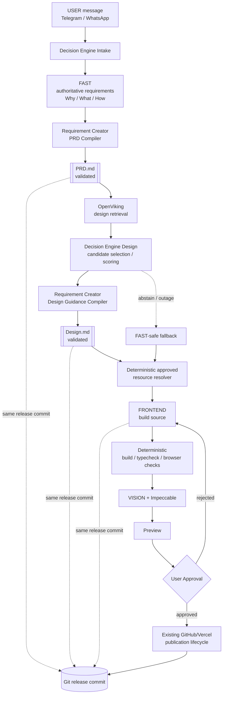
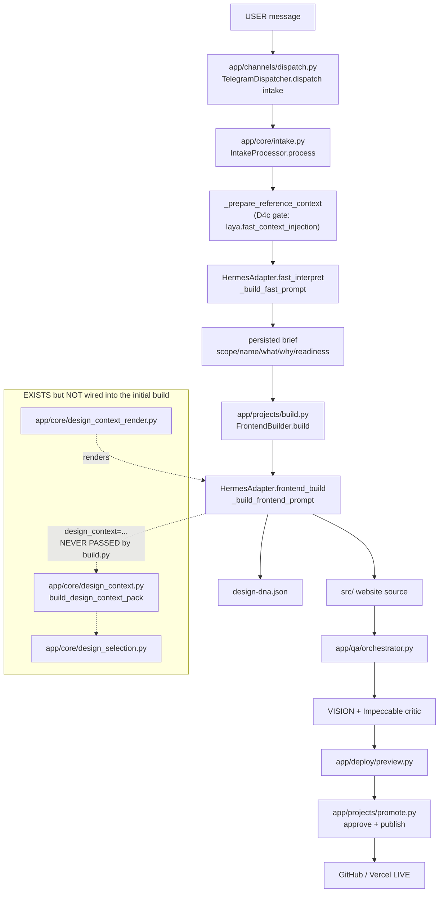
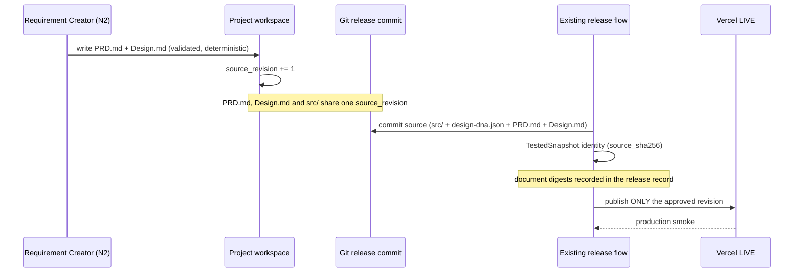

# N1 — Architecture & Document Contracts (Hermes Website R2)

Status: N1 deliverable. Batch **N1 — Architecture & Document Contracts**.
Worktree: `/home/albertus527/hermes-website-r2`
Branch: `feature/website-r2-redesign`
Baseline HEAD: `d0016be5a0cb7a860251f338d84e00ac688242f6`

This document is the **N1 architecture contract**. It is documentation plus a
small, additive, side-effect-free module (`app/core/document_contracts.py`). It
**changes no pipeline behaviour**: nothing in the FAST → FRONTEND → QA →
publication path imports the new module in N1.

Gate for N1 (from the approved roadmap, `autodev/plans/roadmap_n1_n5.md`):

> - Existing behavior remains unchanged.
> - Contracts are deterministic and tested.
> - No production modification.

---

## 1. Target architecture (approved roadmap)

```
USER
→ Decision Engine Intake
→ FAST (authoritative requirement interpreter; Why/What/How)
→ Requirement Creator (PRD compiler)
→ PRD.md
→ OpenViking design retrieval
→ Decision Engine Design (candidate selection/scoring)
→ Requirement Creator (Design Guidance compiler)
→ Design.md
→ Deterministic approved resource resolver
→ FRONTEND
→ deterministic build/typecheck/browser checks
→ VISION + Impeccable
→ Preview
→ User Approval
→ existing GitHub/Vercel publication lifecycle.
```

**Invariant (roadmap, line 27):** `PRD.md`, `Design.md`, and the generated
website source must belong to the **same exact Git release commit**.

### 1.1 Mermaid workflow (R2 target)



The dotted edges are the N1 invariant: all three artifacts (PRD.md, Design.md,
generated source) are pinned to one Git release commit — never a second release
state machine.

### 1.2 Current (pre-N1) runtime call graph — code-backed

Traced from the live tree at baseline HEAD, not guessed:



---

## 2. Code-backed impact audit

Every claim below cites the file and the exact symbol verified in the tree.

### 2.1 FAST — authoritative requirement interpreter

| Question | Answer (verified) |
|---|---|
| Single authoritative FAST call | `HermesAdapter.fast_interpret(...)` in `app/hermes/adapter.py:1221` |
| Called from | `IntakeProcessor.process` in `app/core/intake.py:420` (and the `:429` path) |
| Prompt builder | `HermesAdapter._build_fast_prompt` `app/hermes/adapter.py:1256` |
| Response parser | `HermesAdapter._parse_fast_response` `app/hermes/adapter.py:1337` |
| Reference-context seam | `IntakeProcessor._prepare_reference_context` `app/core/intake.py:328` (D4c gate) |

FAST produces the persisted brief (`scope`, `name`, `what`, `why`, `readiness`).
**FAST remains authoritative for requirements and scope** (roadmap N2). N1 does
not touch this path.

### 2.2 Laya / OpenViking

| Component | Location | State |
|---|---|---|
| Context preparer | `app/core/laya_context.py` (47 KB) | Present, default-OFF |
| OpenViking retrieval | `app/core/openviking_retrieval.py`, `openviking_live.py`, `openviking_library.py`, `openviking_corpus.py` | Present |
| FAST handoff gate | `laya.fast_context_injection` (D4c) | **default `false`** in `config/default.yaml` |
| Enable gate | `laya.enabled` | **default `false`** |

Three independent default-OFF flags; enabling one never enables another
(`config/default.yaml` lines 78–90). N3 owns the Decision Engine work; N1 only
audits.

### 2.3 Design resource activation / selection / context

| Module | Role | Wired into the initial build? |
|---|---|---|
| `app/core/design_capabilities.py` | D0 availability preflight | via `app/runtime.py` preflight |
| `app/core/design_activation.py` | D1 resource activation (`activate_design_resources`) | **No** — called only from tests |
| `app/core/design_selection.py` | D2 selection (`select_design_resources`, `derive_design_requirements`) | **No** — called from `design_context.py` and tests only |
| `app/core/design_context.py` | D2 `build_design_context_pack` | **No** — called only from tests |
| `app/core/design_context_render.py` | `render_design_context_block` | Renders only if a pack is passed |

`build_design_context_pack` has **no production caller** — verified by
`grep -rn build_design_context_pack website-builder` (only `tests/test_design_selection.py`).

### 2.4 Design DNA

| Question | Answer (verified) |
|---|---|
| Canonical reader | `load_persisted_design_dna` `app/core/design_dna.py:75` |
| Canonical keys | `CANONICAL_DESIGN_DNA_KEYS` `app/core/design_dna.py:29` |
| Legacy unwrap | `unwrap_design_dna` `app/core/design_dna.py:45` |
| Produced by | FRONTEND (`design-dna.json` in the workspace) |
| Typography validator | `validate_typography` `app/core/design_dna.py:107` |

Design DNA is the machine design source of truth today. N1 defines `Design.md`
as the human-readable document and specifies **non-contradiction** (not equality)
compatibility with `design-dna.json` (§5).

### 2.5 FRONTEND

| Question | Answer (verified) |
|---|---|
| Entry point | `HermesAdapter.frontend_build` `app/hermes/adapter.py:1523` |
| Prompt builder | `_build_frontend_prompt` `app/hermes/adapter.py:1678` |
| Accepts a design-context pack? | **Yes** — `design_context=None` param, `:1530` and `:1683` |
| Initial-build caller | `FrontendBuilder.build` `app/projects/build.py:738` |
| Passes `design_context`? | **No** |

### 2.6 VISION + Impeccable

| Component | Location | State |
|---|---|---|
| VISION role | `HermesAdapter.vision_inspect` `app/hermes/adapter.py:1758` | Present (zero-tool) |
| Impeccable critic | `app/core/design_critic.py`, `app/qa/critic_stage.py` | Present (D3b) |
| Critic repair | `app/core/critic_repair.py` | Present, bounded |

### 2.7 Publication / revision integration

| Component | Location |
|---|---|
| Revision counters | `RevisionState` `app/core/state.py:127` (`requirements_version`, `design_dna_version`, `source_revision`, …) |
| Snapshot / identity | `TestedSnapshot` `app/deploy/snapshot.py` |
| Hydration | `app/deploy/hydrate.py` (`RevisionBase`, `HydrationRecord`) |
| Release record | `app/projects/release.py` (`validate_last_live_release`, `commit_release`) |
| Promotion / publish | `app/projects/promote.py` (`PromotionOrchestrator.approve/promote`) |
| Revision apply | `app/projects/revise.py` |

There is **one** release state machine. N1's Git lifecycle contract (§6) binds
documents to it; it does **not** create a second one.

---

## 3. Confirmed initial-build design-context handoff gap

**Finding (verified in source, not inferred):** the D2/D3a design-context seam
was built end-to-end *except for the initial-build call site*.

* `HermesAdapter.frontend_build` **accepts** `design_context` (`adapter.py:1530`)
  and threads it into `_build_frontend_prompt(design_context=...)`
  (`adapter.py:1549`, `:1683`), which renders it via `render_design_context_block`
  (`adapter.py:1705`).
* **Every production caller omits it.** Verified by reading each call site:

| Call site | Passes `design_context`? |
|---|---|
| `app/projects/build.py:738` — initial build | **No** |
| `app/projects/build.py:607` — compile repair | **No** |
| `app/projects/revise.py:602` — revision apply | **No** |
| `app/qa/orchestrator.py:489` — critic repair | **No** |
| `app/qa/orchestrator.py:715` — QA repair | **No** |

Consequently `render_design_context_block(None)` returns `""`
(`design_context_render.py:35`), and the FRONTEND prompt interpolates an empty
string at the `{design_context_block}` slot (`adapter.py:1739`). **FRONTEND on the
initial build never receives the selected design resources or dependencies** —
the D2 selection is computed but never reaches the model.

**Scope of the gap (honest):** this is a *handoff* gap, not a correctness bug.
The seam, the pack, the bounds, the trust labelling, and the tests all exist; the
initial-build caller simply does not build and pass a pack. N4 ("Feed validated
PRD.md and Design.md into FRONTEND") is where the roadmap closes it. N1's job is
to **record the gap precisely and define the contract N4 will implement against**
— not to wire it (wiring would change pipeline behaviour, which the N1 gate
forbids).

**Non-goals confirmed unchanged by N1:** no FRONTEND rewrite, no FAST rewrite, no
Design DNA precedence change, no change to `design_context` semantics.

---

## 4. Component authority & trust boundaries

| Component | Authority | Trust of its inputs |
|---|---|---|
| FAST | **Authoritative** for requirements/scope. No publication authority. | User text trusted as intent; retrieved reference data is lower-trust DATA |
| Requirement Creator (N2) | **Compiles**, never authors. Compiles FAST's decision into PRD.md / Design.md. | FAST output authoritative; must not invent business facts |
| Decision Engine (N3) | **Advises** design candidates. | Retrieved candidates untrusted; may abstain; never overrides FAST |
| OpenViking | **Supplies** candidate content. | Lower-trust DATA; provenance required; bounded |
| FRONTEND | **Owns** design discovery, Design DNA, implementation. | Consumes PRD.md / Design.md / context pack as DATA |
| VISION + Impeccable | **Evaluate** only. Evidence, never authority. | Screenshots + DNA; zero-tool |
| Application code | **Owns** lifecycle, budgets, gates, publication. | Enforces all invariants structurally |

**Trust boundary rule (carried forward from D2/D3a/D4c):** retrieved/compiled
content is *DATA the model reads*, never *instructions the model obeys*. The
boundary holds structurally (selection precedes retrieval, outside FRONTEND;
installer acts only on a plan), not by asking the model to behave.

### 4.1 Fallback policy (closed set)

| Situation | Fallback | Never |
|---|---|---|
| Decision provider outage (N3) | FAST-safe deterministic path | Never break FAST intake |
| No suitable design candidate | Abstain | Never force a selection |
| Invalid/untrusted candidate | Reject | Never override requirements |
| Missing PRD/Design (legacy project) | Legacy path | Never fail a legacy project |
| Design-context pack absent | Empty block (byte-identical prompt) | Never inject a fabricated pack |
| OpenViking unavailable | Honest-empty / degraded | Never present unverified content as relevant |

---

## 5. Canonical document contracts

Implemented in `app/core/document_contracts.py`. Schemas are **versioned**:
`PRD_SCHEMA_VERSION = 1`, `DESIGN_SCHEMA_VERSION = 1`.

### 5.1 Shape

A document is `---` front matter (restricted flat `key: value` scalars) followed
by a markdown body of `##`-delimited sections.

**Required front-matter fields:** `document` (`prd`\|`design`),
`schema_version`, `project_id`, `source_revision`, `generator`,
`generator_version`.
**Optional:** `requirements_version`, `design_dna_version`.
**Unknown fields are a hard error** (`ERR_UNKNOWN_FIELD`) — a typo'd field must
not silently vanish.

**Required sections**
* `PRD.md`: `## Requirements`, `## Scope`, `## Acceptance Criteria`.
* `Design.md`: `## Brand Personality`, `## Palette`, `## Typography`, `## Layout`.

Section headings are normalised (case- and punctuation-insensitive) to slugs, so
`## Acceptance Criteria` ≡ `## acceptance_criteria`.

### 5.2 Stable identity & provenance

* `document_id = "<kind>:<project_id>"` — **stable across revisions**.
* `revision_id = "<document_id>:r<source_revision>"` — **bound to the release
  source**, so a document can be tied to the exact Git release commit.
* `DocumentIdentity` carries `project_id`, `source_revision`,
  `requirements_version`, `design_dna_version`, `generator`, `generator_version`.

### 5.3 Determinism

`serialise_document` emits front-matter keys in **sorted order** and a
single-trailing-newline body, so the same logical document is **byte-identical**
and `document_digest` (SHA-256) is stable. This is what makes a release commit
reproducible and what lets N2 pin a document digest into the release record.

### 5.4 Validation (deterministic, no side effects)

`validate_document` / `validate_prd` / `validate_design` return
`(identity, violations)` and **never raise on bad content** — they report stable
codes:

`MISSING_FRONT_MATTER`, `UNTERMINATED_FRONT_MATTER`, `MALFORMED_FRONT_MATTER`,
`UNKNOWN_FIELD`, `MISSING_FIELD`, `INVALID_KIND`, `INVALID_SCHEMA_VERSION`,
`INVALID_SOURCE_REVISION`, `INVALID_VERSION_COUNTER`, `INVALID_IDENTIFIER`,
`MISSING_SECTION`, `EMPTY_SECTION`, `LEGACY_CONTRADICTION`.

Only a structurally unparseable document raises (`DocumentContractError`).

### 5.5 Legacy & `design-dna.json` compatibility

* A project with **neither** document is a **legacy (R1) project** —
  `DocumentPresence.legacy` is `True`. Absence is a **supported state**, not an
  error, so N2 adopts documents without a migration flag day.
* **Partial** presence (exactly one document) is flagged (`partial=True`), not
  silently treated as complete.
* `design_dna_compatible` enforces **non-contradiction**: a `Design.md` section
  must not assert a value conflicting with the persisted `design-dna.json`. A
  `None` DNA is compatible with everything (legacy).

---

## 6. Git-backed document lifecycle contract

Documents are ordinary repository files **inside the generated website source**,
so they ride the existing Git release commit — no second state machine.



Rules:

1. **One commit, three artifacts.** `PRD.md`, `Design.md`, and generated source
   are committed together; the release commit is the single binding.
2. **No new state machine.** Document identity is *derived* from
   `source_revision` (already in `RevisionState`), not a new persisted machine.
3. **Revisions hydrate the LIVE commit's documents.** A revision reads the exact
   documents of the LIVE commit (N2), consistent with `app/deploy/hydrate.py`.
4. **Publication gate unchanged.** `app/projects/promote.py` keeps its approval
   and release-identity invariants; documents are *content*, not a new gate.
5. **Digest pinning (N2).** The release record MAY carry the document digests so
   QA evaluates the same document version FRONTEND used (roadmap N4 gate).

---

## 7. Failure matrix

| ID | Failure | Detection | Behaviour | Authority preserved |
|---|---|---|---|---|
| F1 | FAST unavailable | adapter error result | Intake returns structured failure; no fabricated brief | FAST |
| F2 | PRD/Design invalid | `validate_*` returns violations | Reject document; do not compile downstream | Application |
| F3 | Document contradicts DNA | `ERR_LEGACY_CONTRADICTION` | Reject; require recompile | Application |
| F4 | Partial documents | `DocumentPresence.partial` | Treat as unsupported; do not assume complete | Application |
| F5 | Legacy project (no docs) | `DocumentPresence.legacy` | Legacy path; never fail | Application |
| F6 | OpenViking outage | retrieval `unavailable` | Fail-closed; honest-empty; FAST unaffected | FAST |
| F7 | No suitable candidate | decision abstain | No forced selection | FAST |
| F8 | Untrusted candidate | provenance/score validation | Reject candidate | Application |
| F9 | Design-context absent | `render(None) == ""` | Byte-identical prompt | Application |
| F10 | Git conflict on publish | existing release flow | Existing reconcile/resume; never force-push | Application |
| F11 | Crash mid-batch | persisted `source_revision` / checkpoint | Resume from validated state | Application |
| F12 | QA failure | existing QA gate | Blocked; never "ready to publish" | Application |
| F13 | Release identity mismatch | `TestedSnapshot.identity` | Refuse publication | Application |
| F14 | Unapproved publication | `PromotionOrchestrator` approval gate | Refuse; require explicit human approval | Human |

---

## 8. Acceptance criteria for N1

1. **Existing behaviour unchanged.** `document_contracts.py` has no production
   importer; the initial-build path is byte-identical.
2. **Contracts deterministic.** `serialise_document` is order-independent;
   `document_digest` is stable.
3. **Contracts tested.** `tests/test_document_contracts.py` — 31 tests, 8 subtests,
   all passing; every guard proven load-bearing by `tools/mutation_check_n1.py`
   (**13/13 killed**).
4. **No production modification.** No change to runtime, publication, or config.
5. **Gap recorded.** §3 documents the confirmed handoff gap with exact call sites.
6. **Legacy supported.** Absence and partial presence are explicit, tested states.
7. **Full gate green.** `scripts/run_tests.sh website-builder/tests` passes.

---

## 9. What N1 deliberately does NOT do

* No wiring of `design_context` into the initial build (that is N4; it would
  change behaviour and break the N1 gate).
* No Requirement Creator implementation (N2).
* No Decision Engine / provider interface (N3).
* No new publication state machine, no Git/Vercel invariant change.
* No modification to `autodev/` or `tests/autodev/`.
