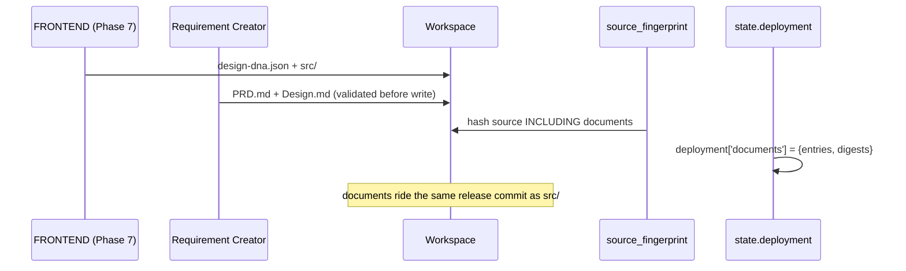

# N2 — Requirement Creator & Git Documents (Hermes Website R2)

Status: N2 deliverable. Batch **N2 — Requirement Creator & Git Documents**.
Worktree: `/home/albertus527/hermes-website-r2`
Branch: `feature/website-r2-redesign`
Baseline: N1 pushed at `1e4f488023befa22c26a427929562e08cdb4c46c`.

This batch implements the **Requirement Creator** — the component the approved
roadmap places between FAST and the rest of the pipeline — and binds the
documents it produces into the existing revision/publication flow.

Gate for N2 (from the approved roadmap):

> - Documents are versioned, consistent, and tied to release source.
> - Legacy projects continue working.
> - No new publication state machine.

---

## 1. What N2 adds

| File | Role |
|---|---|
| `app/core/requirement_creator.py` | The two compilers + feature config |
| `app/core/document_store.py` | Git-backed document storage, identity, digests, hydration check |
| `app/projects/build.py` | Threads compilation into Phase 7 (flag-gated, disabled by default) |
| `app/runtime.py` | `requirement_creator_config` on `RuntimeConfig`; loaded from config.yaml |
| `config/default.yaml` | `website_builder.requirement_creator` block (disabled) |

N2 reuses the N1 contract (`app/core/document_contracts.py`) unchanged: the
compilers are tested to produce documents that pass `validate_prd` /
`validate_design`.

---

## 2. Two modes, one authority

The Requirement Creator runs in **two modes**, both pure and deterministic:

### 2.1 PRD Compiler — `compile_prd(brief, …)`

Compiles FAST's authoritative brief into `PRD.md` with sections
`## Requirements`, `## Scope`, `## Acceptance Criteria`.

* **FAST remains authoritative.** The compiler re-expresses the brief; it never
  decides scope or invents a fact. A missing field becomes an explicit
  `UNRESOLVED` marker.
* **No fabricated business facts.** An empty brief yields an `UNRESOLVED`
  Requirements section — never invented marketing copy (proven by a test that
  asserts the section contains the marker and not filler prose).

### 2.2 Design Guidance Compiler — `compile_design(design_dna, …)`

Compiles the accepted Design DNA into `Design.md` with sections
`## Brand Personality`, `## Palette`, `## Typography`, `## Layout`.

* Section text is derived **from** the DNA, so the document can never assert a
  value the DNA does not carry — compatibility is **non-contradiction**, not
  equality (the N1 rule).
* Missing DNA fields become `UNRESOLVED` markers.

### 2.3 Determinism

Both compilers are byte-deterministic: same input ⇒ identical text. This is what
lets a document digest be pinned into a release commit and keeps the commit
reproducible. There is no wall-clock, randomness, or dict-order dependence.

---

## 3. Git-backed lifecycle (no second state machine)

Rules (verified by tests):

1. **One commit, three artifacts.** Documents are written into the workspace
   *before* `source_fingerprint` is taken, so they are part of the checked
   (`deployment['checked'].source_sha256`) and published bytes.
2. **No new state machine.** Identity is derived from the existing
   `source_revision` and `project_id`. Nothing new is persisted beyond the
   document files and the digest record in the existing `state.deployment`.
3. **Versioned.** Each document records `schema_version`, `generator`,
   `generator_version`, and the `requirements_version` / `design_dna_version`
   it was compiled from.
4. **Consistent.** `verify_records_match_workspace` recomputes each document's
   digest and compares it to the recorded one; a mismatch or a missing document
   is a hard inconsistency, never silently accepted.
5. **Publication untouched.** `app/projects/promote.py` and its release
   invariants are not modified.

---

## 4. Feature flag & legacy compatibility

* `website_builder.requirement_creator.enabled` — **default `false`**.
* When disabled, `_compile_and_store_documents` returns immediately: no document
  is compiled, written, or read, and `state.deployment` gains no `documents`
  key. The build path is byte-identical to pre-N2.
* A malformed or missing config block yields the disabled default. A malformed
  `enabled` value never silently enables the feature.
* A **legacy project** (no documents) reads back `None` for each document and is
  a supported state, not an error. `document_presence_record` reports
  `legacy: true`.
* A **compilation failure never fails the build**: the documents are additive,
  and the failure is recorded in `state.deployment['documents']['error']` for an
  operator. Losing a document must never lose a website.

---

## 5. Acceptance evidence

| Check | Command | Result |
|---|---|---|
| Contract + compiler + store tests | `pytest tests/test_requirement_creator.py` | **30 passed** |
| Build integration tests | `pytest tests/test_requirement_creator_build.py` | **7 passed** |
| Mutation driver | `python tools/mutation_check_n2.py` | **11/11 guards killed** |
| Full suite | `scripts/run_tests.sh website-builder/tests` | compared to the N1 baseline fingerprint (see ledger) |

---

## 6. What N2 deliberately does NOT do

* No Decision Engine / provider interface (N3).
* No feeding of PRD/Design into the FRONTEND prompt (N4 — the confirmed N1
  handoff gap remains open and is N4's to close).
* No new publication state machine, no Git/Vercel invariant change.
* No change to FAST's authority or to the FAST prompt.
* No modification to `autodev/` or `tests/autodev/`.
