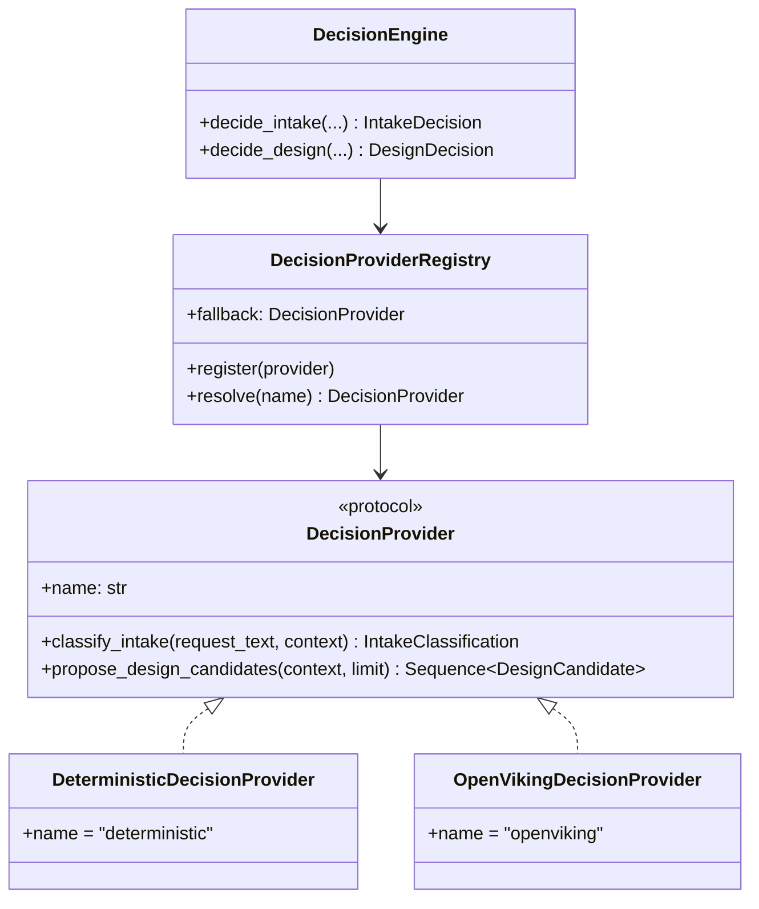

# N3 — Decision Engine & OpenViking (Hermes Website R2)

Status: N3 deliverable. Batch **N3 — Decision Engine & OpenViking**.
Worktree: `/home/albertus527/hermes-website-r2`
Branch: `feature/website-r2-redesign`
Baseline: N2 pushed at `830fd83b114eef0fe461fe7aa368ca9eae3f94af`.

Gate for N3 (from the approved roadmap):

> - Provider outage never breaks the safe FAST fallback.
> - Invalid or untrusted design candidates never override requirements.
> - No forced selection when no suitable design exists.

---

## 1. What N3 adds

| File | Role |
|---|---|
| `app/core/decision_provider.py` | The replaceable `DecisionProvider` interface, `DesignCandidate`, `IntakeClassification`, `ProviderResponse`, the deterministic provider, and the registry |
| `app/core/decision_engine.py` | The engine that enforces the invariants around any provider |
| `app/core/openviking_decision.py` | OpenViking-backed candidate retrieval (built on the D4a seam) |
| `app/core/intake.py` | Shadow-mode observation of the engine (off by default) |
| `config/default.yaml` | (documented) decision-engine config lives here; disabled by default |

Nothing in the **authoritative** FAST path is changed: the engine is observed in
shadow mode and never supplies the intake result.

---

## 2. Replaceable provider interface

The interface is a `Protocol`, so any object with the right methods is a
provider — no inheritance required. The **deterministic provider is always
registered**, so `resolve()` can never return `None` and the pipeline always has
a decision backend.

### 2.1 Decision Intake

`DecisionEngine.decide_intake` classifies a request as `new` / `revision` /
`unknown` and detects whether a reference was supplied. The deterministic
classifier is keyword-based; a revision requires an existing source, so
"change" on a brand-new project is not a revision.

### 2.2 Decision Design

`DecisionEngine.decide_design` retrieves and ranks candidate design directions.
The deterministic provider derives candidates **only from the context's own
approved Design DNA** — it cannot invent a design the application did not
authorise. The OpenViking provider retrieves candidates through the D4a adapter.

---

## 3. The three invariants (structurally enforced)

### 3.1 Provider outage never breaks the safe FAST fallback

Every provider call is wrapped in `try/except`. Any raised error — or a
non-conforming return — becomes a labelled unavailability, and the engine
retries **once** with the deterministic provider:

| Outcome | `source` | `degraded` | `error_code` |
|---|---|---|---|
| provider OK | `provider` | `false` | `""` |
| provider raised | `fallback` | `true` | the exception code |

The engine therefore **always returns** a decision. Proven by mutation guards
`intake-no-fallback` and `design-no-fallback`.

### 3.2 Invalid or untrusted candidates never override requirements

* A candidate without **complete provenance** (`source_uri` AND
  `source_revision`) is **dropped** before ranking.
* A candidate whose **score is not a finite value in `[0, 1]`** has its score
  pinned to `0.0` and is marked `score_unvalidatable` — it can never pass the
  floor on a bogus value.
* A non-object item, a duplicate id, or a missing required field is rejected at
  the normalisation boundary.

The candidate type carries **no field** that could hold a requirement, an
override, or an instruction. Proven by the `hostile provider` test and mutation
guards `provenance-not-required`, `score-range-unchecked`, `nan-inf-not-rejected`.

### 3.3 No forced selection when no suitable design exists

When no candidate survives validation and the score floor, the engine
**abstains**: `selected is None`, `abstained is True`, and a closed-set
`abstain_reason` (`no_candidates` / `below_score_floor` / `no_provenance`). It
never fabricates a selection. Proven by mutation guard `forced-selection`.

### 3.4 Bounded retrieval

The candidate limit is a hard cap (`MAX_CANDIDATES = 8`) enforced by the engine
independent of the provider, and the OpenViking provider caps its own output.
Proven by mutation guard `bound-not-enforced`.

### 3.5 Deterministic ranking

Ranking is by score descending, then `candidate_id` ascending, so equal scores
never depend on provider iteration order. Proven by mutation guard
`rank-not-deterministic`.

---

## 4. Shadow mode (roadmap rule 4)

The roadmap requires new runtime behaviour to be *"feature-flagged or
shadow-mode"*. The engine is wired into `IntakeProcessor` in **shadow mode**:

* `IntakeProcessor(..., decision_engine=None)` by default ⇒ the intake path is
  byte-identical to pre-N3.
* When an engine is supplied, the processor records
  `self.last_shadow_decision` for observability **and returns the unchanged
  `IntakeResult`**. FAST remains authoritative; the engine is observed, never
  obeyed.
* A shadow failure is swallowed — it can never break intake.

This is proven by `ShadowModeIntakeTests` (records a decision; result unchanged;
failure swallowed) and mutation guard `shadow-mode-must-not-break-intake`.

---

## 5. OpenViking candidate retrieval

`OpenVikingDecisionProvider` is built on the existing D4a adapter, inheriting
its provenance, isolation, and fail-closed behaviour:

* **Bounded** — `MAX_OPENVIKING_CANDIDATES = 6`, and the D4a adapter bounds
  queries and items.
* **Provenance required at the source** — an item without `source_uri` +
  `source_revision` is dropped here, before it can reach the engine.
* **Fail-closed** — a disabled provider, a missing query/scope, or an adapter
  outage returns an empty list (honest-empty). The engine then abstains and FAST
  is unaffected.

---

## 6. Acceptance evidence

| Check | Command | Result |
|---|---|---|
| Decision engine + provider + OpenViking tests | `pytest tests/test_decision_engine.py` | **27 passed, 4 subtests** |
| Mutation driver | `python tools/mutation_check_n3.py` | **12/12 guards killed** |
| Full suite | `scripts/run_tests.sh website-builder/tests` | compared to the baseline fingerprint (see ledger) |

---

## 7. Laya retirement

The roadmap says Laya planning may be retired *only after parity and fallback
tests pass*. N3 does **not** retire Laya: it adds the Decision Engine alongside
the existing (default-OFF) Laya path. Retirement is deferred until the
provider-outage and abstention behaviour is proven in N5's regression/replay
batch, as the roadmap requires.

---

## 8. What N3 deliberately does NOT do

* No change to FAST's authority, prompt, or the intake result.
* No retirement of Laya (gated on parity + fallback tests).
* No feeding of design candidates into FRONTEND (N4).
* No new publication state machine, no Git/Vercel invariant change.
* No modification to `autodev/` or `tests/autodev/`.
