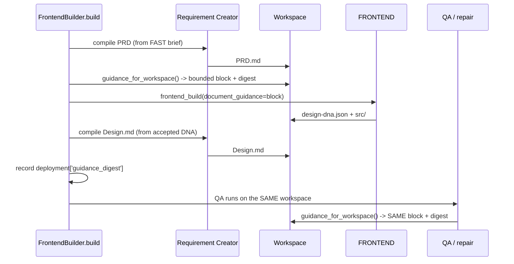

# N4 — Execution & Design Quality (Hermes Website R2)

Status: N4 deliverable. Batch **N4 — Execution & Design Quality**.
Worktree: `/home/albertus527/hermes-website-r2`
Branch: `feature/website-r2-redesign`
Baseline: N3 pushed at `7c9daa42c8a84d7c84fa8525d223f8abb8412190`.

Gate for N4 (from the approved roadmap):

> - Design guidance demonstrably reaches FRONTEND.
> - QA evaluates the same version of the specification used by FRONTEND.
> - No security or dependency-policy relaxation.

N4 is where the N2 documents actually **reach FRONTEND** — closing the
initial-build design-context handoff gap recorded in the N1 architecture
contract.

---

## 1. What N4 adds

| File | Role |
|---|---|
| `app/core/document_guidance.py` | Bounded PRD/Design guidance block + parity digest |
| `app/hermes/adapter.py` | `frontend_build(..., document_guidance=...)` → prompt |
| `app/projects/build.py` | Compiles PRD **before** FRONTEND; Design **after**; records digest |
| `app/qa/orchestrator.py` | Repair calls pass the same workspace-derived guidance |
| `app/projects/revise.py` | Revision call passes the same guidance |

---

## 2. Design guidance reaches FRONTEND

**Ordering constraint (documented, not an omission).** The Design DNA does not
exist until FRONTEND has produced it, so on the *initial* build FRONTEND
receives the **PRD** guidance but not Design.md — Design.md is compiled
immediately after and is available to every later FRONTEND call (QA repair,
compile repair, revision). This is the honest limit of the initial-build
handoff, and it is exactly why the PRD is compiled *before* FRONTEND.

---

## 3. QA evaluates the same version (the parity gate)

`guidance_for_workspace(workspace)` is the **single** derivation used by both the
build path and every QA/repair path. It returns `(block, digest)`.

* The **digest** is a SHA-256 over each document's own SHA-256, in a fixed
  order, so it changes if *either* document changes and distinguishes which
  document is which.
* The build records `deployment['guidance_digest']`. QA and any later reader
  derive the same digest from the same workspace, so "QA evaluated the same
  version FRONTEND was given" is a **checkable** property, not a claim.

---

## 4. Bounded, DATA, deterministic

* **Bounded** — `MAX_GUIDANCE_CHARS = 8_000`, with a hard backstop that holds
  even if the fixed framing alone exceeds a caller-supplied ceiling.
* **DATA** — the block is labelled
  `=== PRD & DESIGN GUIDANCE (application-generated, bounded DATA) ===` and
  states plainly that it is not an instruction and never overrides the brief.
  FRONTEND remains the designer; FAST remains the requirements authority.
* **Deterministic** — same documents ⇒ byte-identical block and digest.
* **Legacy preserved** — an empty document set yields `""`, so a workspace with
  no documents (and the whole feature-off path) produces a prompt
  **byte-identical** to pre-N4 (proven by a test).

---

## 5. Bug fixed during N4

While splitting the compile step, the initial design let the post-FRONTEND
Design compile **overwrite** a PRD compile failure in
`deployment['documents']`. Fixed by a merge that:

* resets the entry set only when the **source revision** changes;
* replaces a kind's entry and clears its error on a **success**;
* records a kind's error **without** removing another kind's entry on a
  **failure**.

Covered by `test_prd_failure_is_not_erased_by_a_successful_design_compile` and
mutation guard `a Design success does not erase a recorded PRD failure`.

---

## 6. Acceptance evidence

| Check | Command | Result |
|---|---|---|
| Guidance tests | `pytest tests/test_document_guidance.py` | **13 passed** |
| Build integration | `pytest tests/test_requirement_creator_build.py` | **11 passed** |
| Mutation driver | `python tools/mutation_check_n4.py` | **10/10 guards killed** |
| Full suite | `scripts/run_tests.sh website-builder/tests` | compared to the baseline fingerprint (see ledger) |

---

## 7. What N4 deliberately does NOT do

* No security/dependency-policy change; the build/typecheck/allowlist/credential
  and browser-smoke gates are untouched.
* No second publication state machine; no Git/Vercel invariant change.
* No change to FAST's authority.
* No modification to `autodev/` or `tests/autodev/`.
* VISION/Impeccable are not re-pointed at the documents in N4 (the critic/repair
  path already re-derives guidance from the same workspace, so it is consistent
  by construction); any explicit VISION-document wiring is deferred to N5's
  regression scope.
